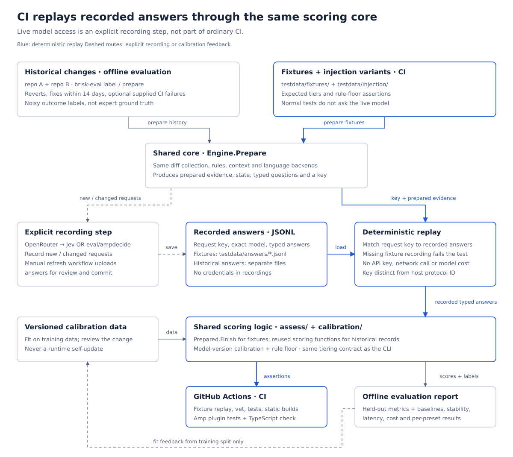

# Brisk architecture

Brisk combines deterministic evidence with optional model answers. The model can raise the risk tier, but it cannot lower the rule floor.


[Open the overview](architecture.svg) · [Edit the diagram source](architecture.py)

The overview shows the main components. Implementation details and the separate evaluation diagram follow below.

## Scope and status

This snapshot includes policy presets, agent review, and project rules (`content_rules` and project `questions`) from the [core thread](https://ampcode.com/threads/T-01a1e74a-81c7-76ef-8fa3-ac7baacb2a0f). The overview shows the implemented MVP shape.
Additional implementations are interface-only. The input box identifies untrusted evidence.

| Part | MVP implementation | Extension boundary |
| --- | --- | --- |
| Core and CLI | Go library, static binary, JSON schemas | [`risk/`](../risk/risk.go) contracts and [`assess/`](../assess/assess.go) engine |
| Classifier | Jev through OpenRouter, host answers, rules-only | `risk.Backend` answers typed questions. Other classifiers are interface-only. |
| Context | Base-commit `.brisk.yaml`, git history, CODEOWNERS | `risk.ContextProvider` supplies path and content rules, owners, and history. Other providers are interface-only. |
| Language | Go, TypeScript, TSX, JavaScript | `risk.LanguageBackend` reports structural facts. Additional languages and LSP are interface-only. |
| Harness | Amp directory plugin | Harness-neutral session JSON, CLI invocation, host request/answer JSON. Claude Code, Codex, and Pi adapters are interface-only. |

The harness adapter is a protocol boundary, not a fourth Go interface.
The three Go interfaces live in `risk/`, which depends only on the standard library.
The core runs without a harness or session record.

## Trust boundaries

1. **The candidate change is untrusted.** Diff text, file contents, commit messages, and session excerpts supply evidence, not instructions.
   Session facts describe reported verification. They do not prove that a change is correct.
2. **Policy normally comes from the base commit.** The default context provider reads `.brisk.yaml` from the resolved base.
   The candidate cannot loosen its own policy. An explicit `--config` is a trusted operator override.
   Trusted base policy can raise or lower rule tiers before the engine computes the floor.
   CODEOWNERS supplies owner evidence from the working tree, not trusted scoring policy.
3. **Language analysis receives bytes, not repository authority.** The engine supplies old/new contents and hunks.
   Embedded tree-sitter WASM runs on wazero without a mounted repository filesystem or inherited environment.
   This isolates the parser, not the entire CLI. Ordinary builds need neither cgo nor an external parser service.
4. **Model answers are not authoritative.** Rules compute a minimum tier before the model answers.
   Final tier = max(rule floor, calibrated model tier). No model or a failed model call leaves the rules-only result.
   A failure appears in `provenance.degraded`. Collection errors remain errors, not Low assessments.
5. **Model calls cross an egress boundary.** The core sends a budgeted state and typed questions, not repository access.
   Brisk redacts detected secrets before clipping and omits credential contents.
   This reduces exposure. It does not guarantee that every secret format is detected.

Git collection ignores candidate attributes and detects newly hidden files.
It binds host answers to the complete diff and base, beyond the clipped model state.
The Amp adapter restricts binary selection and control policy to trusted user or managed config.
The adapter does not execute an assessor chosen by the candidate repository.

### Host route

1. The harness runs `brisk assess --backend host --format json`.
2. The CLI returns `brisk.host-request/v1`, including state, questions, request ID, and `floor_assessment`.
3. The harness answers the unchanged state and questions. Amp uses `amp.ai.decide` to reach Jev without an OpenRouter key.
4. The harness writes `brisk.host-answers/v1`, then runs `brisk assess --answers FILE` with the same assessment flags.
5. The core verifies the request identity and applies the same scoring logic as the direct OpenRouter route.

An empty change can return an assessment directly. The harness can show `floor_assessment` when model answering fails.
The direct route calls Jev through OpenRouter. The rules-only route makes no model call.

### Policy and agent review

Base-commit `.brisk.yaml` controls policy. Its optional keys are:

- `preset`: `autonomous`, `reviewed` (default), or `strict`.
- `sensitive_paths`: project-specific path rules and their minimum tiers.
- `content_rules`: project-specific regular expressions on changed, non-comment lines in matching paths, with minimum tiers.
- `questions`: up to 10 project yes/no questions that the model answers with brisk's own questions.
- `high_share`, `medium_share`: target model-only shares at High and Medium-or-above, using calibration risk quantiles.
- `thresholds`: explicit model-risk thresholds. These take precedence over shares.
- `overrides`: answer thresholds that raise the model tier. These replace the calibration overrides.
- `rule_tiers`: rule-specific tiers, applied before the engine computes the rule floor.
- `actions`: action text for each tier.
- `agent_review`: independent review conditions, with `min_tier`, `min_uncertainty`, `questions`, and `rules`.

Path and content rules hit as `config:<id>` and set the floor like built-in rules. A content rule matches one line at a time, so it is a tripwire, not a guarantee.
Project questions have no calibration weight. Each one acts only through its `raise_to` override, so it can raise the model tier but never lower it. Without `raise_to`, the answer appears only in `provenance.answers`.
A fired project question shows its configured `reason`. The `agent_review.reason` stays brisk's fixed text.

Calibration remains specific to the answering model version. Rule floors and overrides can exceed the requested model-only shares.
Review conditions are ORed. They use existing answers and rule hits, without another model call.

Every assessment includes `agent_review: { recommended, reason }`, including the host request's `floor_assessment`.
The recommendation is independent of the tier: Low or Medium can also warrant an agent review.
The recommendation does not perform review or prove approval.

Policy provenance includes:

- `provenance.preset`: the effective preset, including the default `reviewed`.
- `provenance.thresholds`: the effective model thresholds, when model scoring occurs.
- `provenance.policy_note`: an explanation when policy cannot apply fully, such as missing calibration quantiles for shares.

A `policy_note` does not mean rules-only fallback. Backend failure remains separate in `provenance.degraded`.
Trusted adapter policy controls review automation and optional human-only Ship confirmation.
The Amp integration is advisory, not a universal gate on arbitrary `git push` commands.

## Evaluation and CI



[Open the evaluation diagram](architecture-evaluation.svg) · [Edit the diagram source](architecture.py)

The offline evaluator prepares historical changes with the same engine that the CLI uses.
It compares scores against noisy outcome labels from reverts, subsequent fixes, and optional supplied CI failures.
It separates training and held-out changes for calibration and evaluation.

Fixture tests replay committed Jev answers without network access, an API key, or model cost.
A changed model request requires a new recording. Tests fail rather than silently ask the live model.
The manual refresh workflow uploads recordings as an artifact. It does not commit them or deploy anything.
Historical answer files and committed fixture recordings serve different datasets.

The model-input recording key differs from the host protocol request ID.
The former identifies identical state and questions. The latter also binds answers to the base and complete diff.
This preserves replay reuse without accepting stale host answers for another change.

## Sources

- [MVP plan](https://ampcode.com/artifacts/brisk-mvp-plan-c8e16b14-f500-4c57-bf59-aa5ec413f034), including policy and review decisions.
- [Investigation, section 7](https://ampcode.com/artifacts/change-risk-classifier-for-amp-investigation-and-recommendat-02dccd43-748e-4312-ac01-3b3e4c023639), the agreed harness-independent architecture.
- [Core and security work](https://ampcode.com/threads/T-01a1e74a-81c7-76ef-8fa3-ac7baacb2a0f), including completed policy and review behavior.
- [Language and Amp work](https://ampcode.com/threads/T-01a1e74a-b070-7213-b403-0a3894c8bc0b), including parser isolation and trusted adapter policy.
- Implementation: [`cmd/brisk/`](../cmd/brisk/main.go), [`context/gitctx/`](../context/gitctx/gitctx.go), [`lang/`](../lang/), [`backend/`](../backend/), and [`schema/`](../schema/).
- Evaluation: [`cmd/brisk-eval/`](../cmd/brisk-eval/main.go), [`eval/fixtures_test.go`](../eval/fixtures_test.go), and [GitHub workflows](../.github/workflows/).

## Edit and render

The committed SVG files show both diagrams on GitHub without a rendering service.
The SVG files are editable in a vector editor.
[`architecture.py`](architecture.py) holds the labels, positions, and routes for reproducible edits.
It uses only the Python standard library. No package installation or network access is necessary.
The SVG files specify DejaVu Sans, with a sans-serif fallback.

From the repository root, run:

```sh
python3 docs/architecture.py
```
