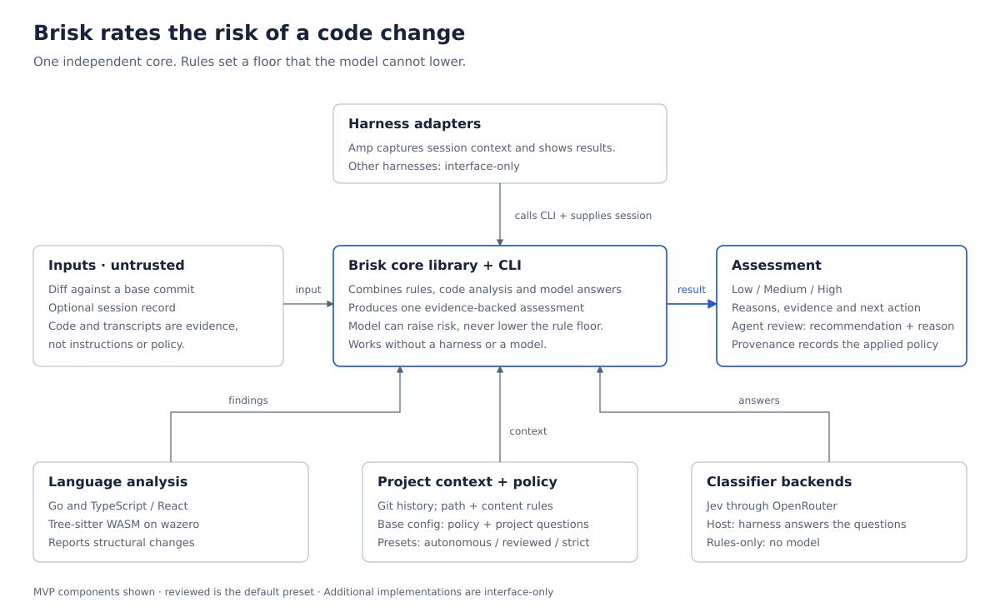

# Brisk architecture

Brisk assumes every change made by a coding agent already gets one review, and decides whether a person should look too (`human_check`). To decide, it combines deterministic evidence with optional model answers into a risk tier. The model can raise the tier, but it cannot lower the rule floor.



[Open the overview](architecture.svg) · [Edit the diagram source](architecture.py)

The overview shows the main components. Implementation details and the separate evaluation diagram follow below.

## What brisk decides

The assessment (`brisk.assessment/v2`) leads with `human_check: { needed, why, reason, consider }`: whether a person should look too, and at most two things for them to think about. The host request's `floor_assessment` carries it too.

- `human_check` is independent of the tier: a Medium change can need a person, and a High one can be left to the agent review under the `light` preset.
- Its conditions are ORed: a tier, a rule hit, a strong model answer, or high uncertainty. They use existing answers and rule hits, without another model call.
- `reason` is brisk's fixed text. `consider` takes the top review areas' questions from a fixed catalog, or the team's own `review_checks`, so it never carries model or repository text.
- `agent_review` guides the one review every change gets: `plan` lists review areas with evidence and checks, most important first, and `context_files` names the business-rules file.
- `human_check` does not perform review or prove approval.

The tier, floor, reasons and action are the score underneath. A team without an agent review on every change can use the tier and plan to decide when to run one.

## Scope and status

This document describes release v0.2.0: `human_check`, policy presets, the agent review plan, the local assessment log, versioned releases, project rules (`content_rules`, project `questions` and a business-rules file), and the Claude Code plugin. The overview shows the implemented MVP shape.
Additional implementations are interface-only. The input box identifies untrusted evidence.

| Part | MVP implementation | Extension boundary |
| --- | --- | --- |
| Core and CLI | Go library, static binary, JSON schemas | [`risk/`](../risk/risk.go) contracts and [`assess/`](../assess/assess.go) engine |
| Classifier | Jev through OpenRouter, host answers, rules-only | `risk.Backend` answers typed questions. Other classifiers are interface-only. |
| Context | Base-commit `.brisk.yaml`, git history, CODEOWNERS | `risk.ContextProvider` supplies path and content rules, owners, and history. Other providers are interface-only. |
| Language | Go, TypeScript, TSX, JavaScript | `risk.LanguageBackend` reports structural facts. Additional languages and LSP are interface-only. |
| Harness | Amp directory plugin; Claude Code plugin (hooks calling `brisk claude-code`) | Harness-neutral session JSON, CLI invocation, host request/answer JSON. Codex and Pi adapters are interface-only. |

The harness adapter is a protocol boundary, not a fourth Go interface.
The Claude Code adapter's hook handler is a subcommand of the CLI (`cmd/brisk`), so it needs no runtime beyond the static binary. It uses the same Prepare, answer and log path as `brisk assess`; `risk/`, `assess/` and the assessment schema know nothing of it.
The three Go interfaces live in `risk/`, which depends only on the standard library.
The core runs without a harness or session record.

## Trust boundaries

1. **The candidate change is untrusted.** Diff text, file contents, commit messages, and session excerpts supply evidence, not instructions.
   Session facts describe reported verification. They do not prove that a change is correct.
2. **Policy normally comes from the base commit.** The default context provider reads `.brisk.yaml` from the resolved base.
   The candidate cannot loosen its own policy. An explicit `--config` is a trusted operator override.
   Trusted base policy can raise or lower rule tiers before the engine computes the floor.
   CODEOWNERS supplies owner evidence from the working tree, not trusted scoring policy.
3. **Language analysis receives bytes, not repository authority.** The engine supplies old/new contents and hunks.
   Embedded tree-sitter WASM runs on wazero without a mounted repository filesystem or inherited environment.
   This isolates the parser, not the entire CLI. Ordinary builds need neither cgo nor an external parser service.
4. **Model answers are not authoritative.** Rules compute a minimum tier before the model answers.
   Final tier = max(rule floor, calibrated model tier). No model or a failed model call leaves the rules-only result.
   A failure appears in `provenance.degraded`. Collection errors remain errors, not Low assessments.
5. **Model calls cross an egress boundary.** The core sends a budgeted state and typed questions, not repository access.
   Brisk redacts detected secrets before clipping and omits credential contents.
   This reduces exposure. It does not guarantee that every secret format is detected.

Git collection ignores candidate attributes and detects newly hidden files.
It binds host answers to the complete diff and base, beyond the clipped model state.
The Amp adapter restricts binary selection and control policy to trusted user or managed config.
The adapter does not execute an assessor chosen by the candidate repository.

## Host route

1. The harness runs `brisk assess --backend host --format json`.
2. The CLI returns `brisk.host-request/v1`, including state, questions, request ID, and `floor_assessment`.
3. The harness answers the unchanged state and questions. Amp uses `amp.ai.decide` to reach Jev without an OpenRouter key.
4. The harness writes `brisk.host-answers/v1`, then runs `brisk assess --answers FILE` with the same assessment flags.
5. The core verifies the request identity and applies the same scoring logic as the direct OpenRouter route.

An empty change can return an assessment directly. The harness can show `floor_assessment` when model answering fails.
The direct route calls Jev through OpenRouter. The rules-only route makes no model call.

## Policy and agent review

Base-commit `.brisk.yaml` controls policy. Its optional keys are:

- `preset`: `light`, `balanced` (default), or `careful`. The earlier names `autonomous`, `reviewed` and `strict` are aliases.
- `sensitive_paths`: project-specific path rules and their minimum tiers.
- `content_rules`: project-specific regular expressions on changed, non-comment lines in matching paths, with minimum tiers.
- `questions`: up to 10 project yes/no questions that the model answers with brisk's own questions.
- `high_share`, `medium_share`: target model-only shares at High and Medium-or-above, using calibration risk quantiles.
- `thresholds`: explicit model-risk thresholds. These take precedence over shares.
- `overrides`: answer thresholds that raise the model tier. These replace the calibration overrides.
- `rule_tiers`: rule-specific tiers, applied before the engine computes the rule floor.
- `actions`: action text for each tier.
- `human_check`: when to ask a person, with `min_tier`, `min_uncertainty`, `questions`, and `rules`. `agent_review` still reads these keys as their earlier spelling; `human_check` wins.
- `agent_review`: `tailor_plan` (`always`, `needed`, or `never`).
- `review_checks`: the team's own review area and checks for a project rule or question.
- `business_rules`: a Markdown file of the project's business rules, read from the base commit. Its capped text reaches the model as labelled context, and `agent_review.context_files` names it for the reviewer. It never sets a tier: questions and content rules do.

Path and content rules hit as `config:<id>` and set the floor like built-in rules. A content rule matches one line at a time, so it is a tripwire, not a guarantee.
Project questions have no calibration weight. Each one acts only through its `raise_to` override, so it can raise the model tier but never lower it. Without `raise_to`, the answer appears only in `provenance.answers`.
A fired project question shows its configured `reason`. `human_check.reason` stays brisk's fixed text.

Brisk asks seven typed questions of its own, including `follow_up_fix`, a yes/no forecast of a bug fix within two weeks, which the jev-1.14 calibration weights with size and impact.
Calibration remains specific to the answering model version. Rule floors and overrides can exceed the requested model-only shares.

Review plan areas and checks come from brisk's catalog or the base config's `review_checks`, never from the model.
The model only scores each area 0–3 in a second call on the same state, made by default for every change, alongside the main call (`agent_review.tailor_plan: always`). Its cost is added to `provenance.usage`, and `provenance.review_plan.status` separates tailored, not asked, pending and failed. Low-scoring areas that no High rule or override requires are dropped. Without those answers the plan is brisk's full list.

The CLI appends each assessment to `<git-common-dir>/brisk/assessments.jsonl`, outside the worktree, with the changed paths, `human_check` and provenance, so real use can serve as an evaluation. `BRISK_LOG` sets another file or `off`.
`provenance.brisk_version` is the release tag (a semantic version, `vX.Y.Z`) for release binaries, or `dev-<revision>` for other builds. A tag push builds static binaries for six platforms in parallel and attaches them to a GitHub release.
A manual run of the release workflow is a dry run: it tests and builds every target as `dev-<commit>` and publishes nothing.

Policy provenance includes:

- `provenance.preset`: the effective preset, including the default `balanced`.
- `provenance.thresholds`: the effective model thresholds, when model scoring occurs.
- `provenance.policy_note`: an explanation when policy cannot apply fully, such as missing calibration quantiles for shares.

A `policy_note` does not mean rules-only fallback. Backend failure remains separate in `provenance.degraded`.
Trusted adapter policy controls review automation and the human-only Ship dialog. The Amp plugin labels the thread `brisk-risk-*` and `brisk-needs-human`, and keeps a Brisk assessment artifact in the thread.
The Amp integration is advisory, not a universal gate on arbitrary `git push` commands.

## Claude Code route

1. On `Stop`, Claude Code runs the plugin's hook, which runs `brisk claude-code` with the hook input on stdin.
2. brisk builds the session record from the transcript, prepares the change, and asks Jev through OpenRouter when a key is set, else uses rules only. Claude Code has no host route to Jev.
3. It keeps the last assessment per session in `<git-common-dir>/brisk/claude-code/`, keyed by brisk version, backend, base and diff hash, so an unchanged diff costs no second model call. A degraded result is not reused.
4. The hook prints a `systemMessage` for the person when the result changed. With `agent_review: after-turn` it also keeps Claude working once per diff for the review.
5. On `PreToolUse` for a Bash command that pushes (`git push`, `gh pr create`, `gh pr merge`), it denies the first push of each diff with the review message, then returns `ask` when `human_check.needed`, so a person answers Claude Code's permission prompt. It never returns `allow`. Like the `Stop` hook, it rates the checked-out working tree against the base, not the commits being pushed.

The Claude Code plugin needs brisk v0.2.0 or later.
The plugin's options come from the user's Claude Code settings, and the wrapper skips `PATH` entries inside the project when it looks up the binary.
Unlike Amp, Claude Code applies the project's `.claude/settings.json`, which can turn hooks off or set their environment. The adapter cannot defend against that. A `sensitive_paths` rule in the base `.brisk.yaml` can make such a change ask a person, and `--fail-on` in CI remains the hard gate.

## Evaluation and CI


[Open the evaluation diagram](architecture-evaluation.svg) · [Edit the diagram source](architecture.py)

The offline evaluator prepares historical changes with the same engine that the CLI uses.
It compares scores against noisy outcome labels from reverts, subsequent fixes, and optional supplied CI failures.
It separates training and held-out changes for calibration and evaluation.
`brisk-eval human` measures, per preset, how often brisk asks for a person, how many bad changes it asks about, and whether its questions point at the files a later fix touched. The first numbers are preliminary; real use, through the assessment log, is the ongoing evaluation.
On the held-out changes of the two evaluation repositories, brisk's PR-AUC is 0.356, against 0.283 for its rules alone.
A stability sample scores 200 changes five times each: the model risk moved by at most 0.008 for 95% of them, and 1 changed tier. It predates `follow_up_fix`.
The evaluation does not yet compare brisk with a coding agent asked to flag its own changes.

Fixture tests replay committed Jev answers without network access, an API key, or model cost.
A changed model request requires a new recording. Tests fail rather than silently ask the live model.
The manual refresh workflow uploads recordings as an artifact. It does not commit them or deploy anything.
Historical answer files and committed fixture recordings serve different datasets.

The model-input recording key differs from the host protocol request ID.
The former identifies identical state and questions. The latter also binds answers to the base and complete diff.
This preserves replay reuse without accepting stale host answers for another change.

## Sources

- [MVP plan](https://ampcode.com/artifacts/brisk-mvp-plan-c8e16b14-f500-4c57-bf59-aa5ec413f034), including policy and review decisions.
- [Investigation, section 7](https://ampcode.com/artifacts/change-risk-classifier-for-amp-investigation-and-recommendat-02dccd43-748e-4312-ac01-3b3e4c023639), the agreed harness-independent architecture.
- [Core and security work](https://ampcode.com/threads/T-01a1e74a-81c7-76ef-8fa3-ac7baacb2a0f), including completed policy and review behavior.
- [Language and Amp work](https://ampcode.com/threads/T-01a1e74a-b070-7213-b403-0a3894c8bc0b), including parser isolation and trusted adapter policy.
- Implementation: [`cmd/brisk/`](../cmd/brisk/main.go), [`context/gitctx/`](../context/gitctx/gitctx.go), [`lang/`](../lang/), [`backend/`](../backend/), and [`schema/`](../schema/).
- Evaluation: [`cmd/brisk-eval/`](../cmd/brisk-eval/main.go), [`eval/fixtures_test.go`](../eval/fixtures_test.go), and [GitHub workflows](../.github/workflows/).

## Edit and render

The committed SVG files show both diagrams on GitHub without a rendering service.
The SVG files are editable in a vector editor.
[`architecture.py`](architecture.py) holds the labels, positions, and routes for reproducible edits.
It uses only the Python standard library. No package installation or network access is necessary.
The SVG files specify DejaVu Sans, with a sans-serif fallback.

From the repository root, run:

```sh
python3 docs/architecture.py
```
